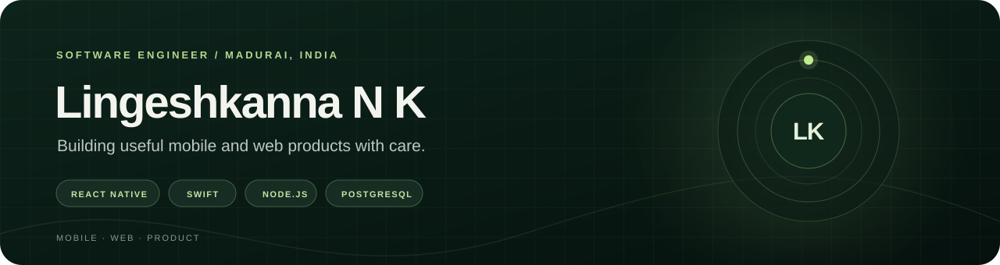

  

  <a href="https://lingeshkanna-portfolio.web.app/">Portfolio</a>
  &nbsp;·&nbsp;
  <a href="https://www.linkedin.com/in/lingeshkanna/">LinkedIn</a>
  &nbsp;·&nbsp;
  <a href="mailto:kannalingesh416@gmail.com">Email</a>

 

At Adhish Technologies, I build mobile and web product features with React Native, Swift, Node.js, and PostgreSQL.

## Selected team projects

- **[GrowPls](https://growpls.app/)** — Plant care across web, iOS, and Android ([App Store](https://apps.apple.com/app/growpls-plant-care-ai/id6817094159) · [Google Play](https://play.google.com/store/search?q=GrowPls&c=apps)).
- **[FullMeals](https://fullmeals.com/)** — Recipe discovery, including video-to-recipe.
- **[Sweet’N’Spicy](https://fullmeals.com/sweetnspicy)** — Indian recipe apps for [iOS](https://apps.apple.com/app/sweetnspicy-indian-recipes/id393738867) and [Android](https://play.google.com/store/apps/details?id=com.sweetnspicy.recipes).
- **[MockRounds](https://mockrounds.com/)** — Interactive quizzes; I contributed during my internship.

## Education

B.Sc. in Information Technology · The American College, Madurai · 2022–2025
